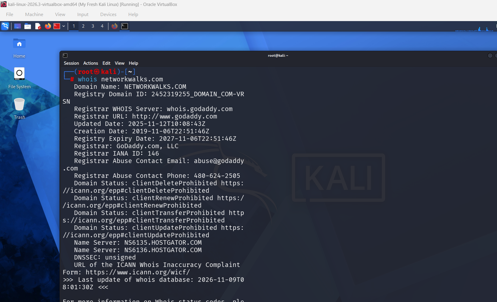
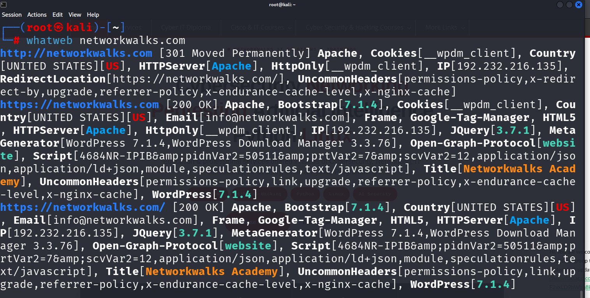
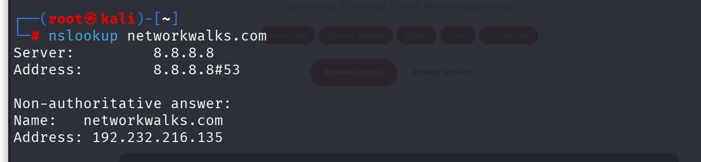
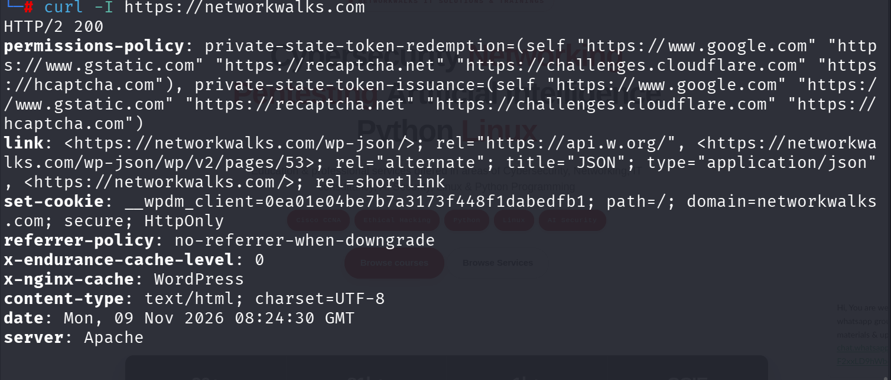
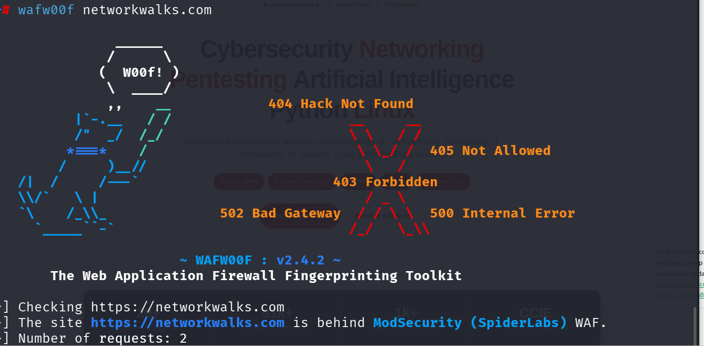
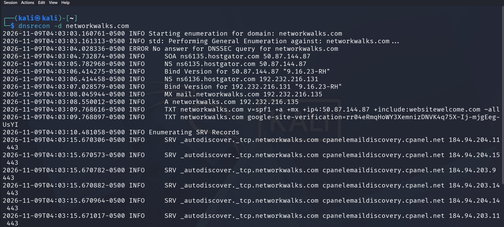
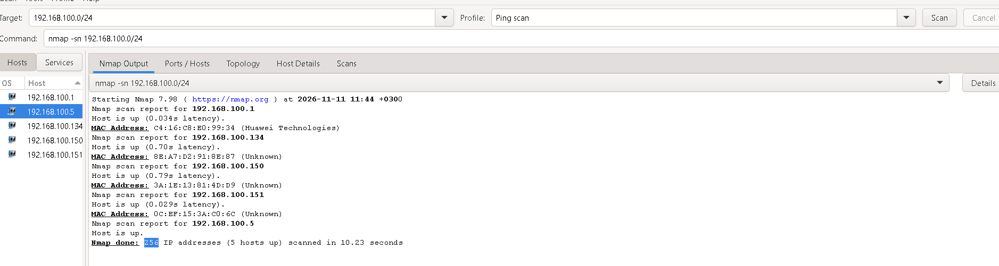

# Network-walks-Week-2-Security-labs
Week 2 Cybersecurity practical exercises covering domain footprinting, reconnaissance, DNS enumeration, website technology identification, HTTP header analysis, Web Application Firewall detection, and local network scanning using Kali Linux and Zenmap. Includes practical commands, scan results, screenshots, risk analysis, security recommendations.

# 🔐 Networkwalks Cybersecurity Program – Week 2


# Cybersecurity Practical Assessment Report

| **Author** | Abdikani Mohamud Jeite |
|---|---|
| **Batch** | B084 |
| **Program** | Networkwalks Cybersecurity Program |
| **Week** | 02 |
| **Date** | 13 November 2026 |
| **Practical Modules** | W2-PM1 – Multiple Kali Linux Tools; W2-PM5 – Zenmap Network Scanning |

## Assessment Scope

**Target Systems:**
- `networkwalks.com` – Domain footprinting and reconnaissance, conducted with written authorization.
- My own local network – Network discovery and scanning using Zenmap.

**Authorization:** Written permission obtained for the domain assessment. Local network scanning was conducted on my own network.

## Phases Covered

- **Phase 1: Reconnaissance and Footprinting** – Gathering publicly available domain information using WHOIS, WhatWeb, Nslookup, cURL, WAFW00F, and DNSRecon.
- **Phase 2: Scanning and Network Discovery** – Identifying active hosts, IP addresses, and MAC addresses on my local network using Zenmap.

## Tools and Technologies

Kali Linux, WHOIS, WhatWeb, Nslookup, cURL, WAFW00F, DNSRecon, Windows CMD, Zenmap, and Nmap.


**Author:** Abdikani Mohamud Jeite  
**Cybersecurity Student | B084**  
**LinkedIn:** https://www.linkedin.com/in/abdikani-jeite-8a714a262?utm_source=share_via&utm_content=profile&utm_medium=member_ios

**GitHub Repository:** `networkwalks-cybersecurity-week02-footprinting-reconnaissance`.

**Liability Disclaimer**

- All activities documented here were carried out only on systems and devices that I own or for which I had obtained proper authorization. The information and materials shared are strictly for educational and research purposes. They should not be used for any illegal or unauthorized activities. I take full responsibility for my actions and how I apply the knowledge gained. Any misuse of these techniques may result in legal consequences, including criminal charges, financial penalties, or other serious consequences. Unauthorized access to computer systems is illegal in many countries, even if no damage is caused.


**Introduction**

In this report, I carried out two main cybersecurity activities as part of Week 2 of my Networkwalks Cybersecurity Program. The first activity involved gathering publicly available information about the networkwalks.com domain using different reconnaissance tools in Kali Linux (W2-PM1). The second activity focused on scanning my own local network using Zenmap to identify active devices and collect network information (W2-PM5).
For the practical exercises, I used a Kali Linux virtual machine running on Oracle VirtualBox to perform the domain reconnaissance activities. I also used Zenmap, installed on my Windows PC, to scan my local network.
Throughout this report, I have included the commands I executed, the results I obtained, screenshots of my activities, and brief explanations of the security importance of each finding. All activities were conducted for educational purposes and within systems and networks I was authorized to assess.

 **Tools Used**
## Tools Used

The following tools and operating systems were used during the practical exercises. Each tool served a specific purpose in gathering domain information, identifying website technologies, or discovering devices connected to my local network.

| **Tool** | **Purpose** |
|---|---|
| Kali Linux & Windows | Operating systems used to perform reconnaissance and network scanning activities. |
| WHOIS | Used to retrieve domain registration information, including registration dates and name servers. |
| WhatWeb | Used to identify website technologies, such as the web server, CMS, plugins, and IP address. |
| Nslookup | Used to query DNS and find the IP address associated with a domain name. |
| cURL (`curl -I`) | Used to retrieve and examine HTTP response headers returned by a website. |
| WAFW00F | Used to check whether a Web Application Firewall (WAF) protects the website. |
| DNSRecon | Used to gather DNS information and identify available DNS records, such as NS, MX, SPF, TXT, and SRV records. |
| Zenmap (Nmap GUI) | Used to scan my local network and identify active hosts, IP addresses, and available MAC address information. |
| Windows CMD | Used to check my computer's local IP address and MAC address. |


## Footprinting & Reconnaissance

### Tool 1: WHOIS – Domain Information Gathering

**Objective**

The objective of this activity was to collect publicly available registration information about the `networkwalks.com` domain using the WHOIS command in Kali Linux.

**Command Used**

```bash
whois networkwalks.com
```

**Results and Observations**

After executing the WHOIS command, I retrieved several details about the domain registration and DNS infrastructure. The results included the domain registrar, registration and expiration dates, name servers, DNSSEC status, and domain protection settings.

The following information was collected during the lookup:

| **Information** | **Observed Result** |
|---|---|
| Domain Name | NETWORKWALKS.COM |
| Registrar | GoDaddy.com, LLC |
| Registrar WHOIS Server | whois.godaddy.com |
| Creation Date | 06 November 2019 |
| Last Updated | 12 November 2025 |
| Expiration Date | 06 November 2027 |
| Name Server 1 | NS6135.HOSTGATOR.COM |
| Name Server 2 | NS6136.HOSTGATOR.COM |
| DNSSEC | Unsigned |
| Domain Status | ClientTransferProhibited |


**Analysis and Security Relevance**

The WHOIS lookup provided useful information about the domain's registration and DNS infrastructure.

- **Registrar Information:** The domain is registered through GoDaddy, which identifies the company responsible for its domain registration.
- **Registration Dates:** The domain was created on 06 November 2019 and is scheduled to expire on 06 November 2027.
- **Name Servers:** The domain uses HostGator name servers, providing information about its DNS hosting infrastructure.
- **Domain Protection:** The transfer, update, deletion, and renewal restrictions indicate that certain domain management operations are restricted.
- **DNSSEC:** The WHOIS result showed that DNSSEC is unsigned, meaning the domain does not currently have DNSSEC signing enabled according to the lookup result.

From a cybersecurity perspective, WHOIS information helps security professionals understand a domain's registration details, hosting infrastructure, and publicly available technical information before conducting further reconnaissance activities.

**Screenshot Evidence**


*Figure 1: Performing a WHOIS lookup on networkwalks.com using Kali Linux to collect domain registration and DNS information.*


## Tool 2: WhatWeb – Website Fingerprinting

### Objective

The objective of this activity was to identify the technologies and web applications running on `networkwalks.com`. I used WhatWeb in Kali Linux to gather information about the website's web server, content management system, frameworks, cookies, IP address, and other publicly detectable technologies.

### Results and Observations

After executing the WhatWeb command, I identified several technologies and details associated with the `networkwalks.com` website.

The target domain initially returned an HTTP response of **301 Moved Permanently**, which redirected the connection to its HTTPS version. The secure HTTPS address then returned a **200 OK** response, indicating that the website was accessible.

The scan identified **Apache** as the web server and revealed the IP address **192.232.216.135**, with the hosting location detected as the United States.

WhatWeb also detected **WordPress 7.1.4** as the website's Content Management System (CMS), along with **Bootstrap 7.1.4** and **jQuery 3.7.1**. Additionally, it identified the WordPress Download Manager plugin version **3.3.76**.

The website title appeared as **Networkwalks Academy**, and the scan revealed the publicly displayed email address **info@networkwalks.com**. Other detected technologies included HTML5, Open Graph Protocol, and Google Tag Manager.

Finally, WhatWeb identified a cookie named `__wpdm_client`, which is associated with the WordPress Download Manager functionality.

**Screenshot Evidence**



## Tool 3: Nslookup – DNS Information Gathering

### Objective

The objective of this activity was to identify the IP address associated with the `networkwalks.com` domain using the `nslookup` command in Kali Linux.

Command Used
**nslookup networkwalks.com**


# **Results and Observations**

After executing the command, I received a DNS response showing that Google's public DNS server (`8.8.8.8`) handled the query. The DNS server was using port `53`, which is the standard port for DNS communication.

The lookup returned a non-authoritative answer, resolving `networkwalks.com` to the IPv4 address **192.232.216.135**.

# **Analysis and Security Relevance**

DNS lookup is an important reconnaissance technique because it helps identify the IP addresses associated with a target domain. This information can support further authorized network assessments.

The IP address obtained also matched the result from my previous WhatWeb scan, confirming consistency between the two findings.

 **Screenshot Evidence**


*Figure 3: Using Nslookup in Kali Linux to identify the DNS server and IP address associated with networkwalks.com.*


# **Tool 4: cURL – HTTP Response Header Analysis**

 **Objective**

The objective of this activity was to examine the HTTP response headers of `networkwalks.com` using the cURL command in Kali Linux. This analysis helped identify information about the web server, website configuration, cookies, and security-related HTTP headers.

 **Command Used**

bash
curl -I https://networkwalks.com

 **Results and Observations**

The cURL command returned an **HTTP/2 200 OK** response, indicating that the server successfully processed the HTTP request.

The response headers identified **Apache** as the web server. The `Content-Type` header returned `text/html; charset=UTF-8`, indicating that the website serves HTML content encoded using UTF-8.

The `Set-Cookie` header revealed a cookie named `__wpdm_client`, with the `Secure` and `HttpOnly` attributes enabled. These attributes help protect the cookie by ensuring it is transmitted over secure HTTPS connections and preventing direct access through client-side JavaScript.

The `Link` header exposed the website's WordPress REST API endpoint (`/wp-json/`) and a reference to a specific WordPress page. This provides additional information about the website's underlying platform and API-related functionality.


 **Analysis and Security Relevance**

HTTP response headers provide useful information about how a website communicates with visitors and how its web server is configured.

Identifying Apache as the web server helps security professionals understand the technologies used by the target website. The WordPress REST API reference also reveals information about the website's underlying content management system and available interfaces.

The cookie attributes are important security observations because `Secure` and `HttpOnly` help reduce certain cookie-related risks. Reviewing security-related HTTP headers can also help identify potential areas for further configuration and security assessment.

Overall, this activity demonstrated how cURL can be used during the reconnaissance phase to collect technical information from a website without downloading its entire content.

 **Screenshot Evidence**

*Figure 4: Using the cURL command in Kali Linux to inspect HTTP response headers and identify web server and security-related information.*


# **Tool 5: WAFW00F – Web Application Firewall Detection**

 **Objective**

The objective of this activity was to identify whether a Web Application Firewall (WAF) was protecting the `networkwalks.com` website. I used WAFW00F in Kali Linux to examine the website's responses and identify the firewall technology, if present.

 **Command Used**


wafw00f networkwalks.com


 **Results and Observations**

After executing the WAFW00F command, the tool successfully checked the `networkwalks.com` website and identified that it is protected by **ModSecurity (SpiderLabs) Web Application Firewall**.

The output confirmed that the website is behind a ModSecurity WAF, which acts as a security layer between incoming web requests and the web application. The tool also reported that it used **2 requests** to identify the firewall.

This finding indicates that the website has a web application security mechanism designed to monitor and filter potentially harmful HTTP requests.

 **Analysis and Security Relevance**

A Web Application Firewall is an important security component that helps protect websites against different types of web-based attacks, including SQL injection and cross-site scripting (XSS).

Identifying ModSecurity during reconnaissance provides useful information about the security technologies deployed by the website. It also demonstrates how WAFW00F can help security professionals identify protective mechanisms during an authorized security assessment.

The presence of a WAF does not guarantee that a website is completely secure, but it provides an additional layer of protection against malicious web traffic.

**Screenshot Evidence**



#  **Tool 6: DNSRecon – DNS Enumeration**

 **Objective**

The objective of this activity was to gather DNS information associated with the `networkwalks.com` domain using DNSRecon in Kali Linux. The purpose was to identify available DNS records, including name servers, mail servers, IP addresses, and other DNS configuration details.

 **Command Used**


dnsrecon -d networkwalks.com


 **Results and Observations**

After executing the DNSRecon command, the tool started the enumeration process and collected several DNS records associated with `networkwalks.com`.

During the scan, DNSRecon reported the **SOA (Start of Authority)** record pointing to `ns6135.hostgator.com`, with the associated IP address `50.87.144.87`. It also identified two name servers: `ns6135.hostgator.com` and `ns6136.hostgator.com`, with their respective IP addresses `50.87.144.87` and `192.232.216.131`.

The scan also revealed the BIND DNS software version as **9.16.23-RH** for the identified DNS server addresses.

Furthermore, DNSRecon identified an **MX (Mail Exchange)** record pointing to `mail.networkwalks.com`, which resolves to `192.232.216.135`. The **A record** also showed that `networkwalks.com` resolves to the same IPv4 address.

The tool discovered two TXT records. One contained SPF information used for email sender verification, while the other contained a Google site verification value.

Additionally, DNSRecon started enumerating **SRV (Service) records** and identified several autodiscover entries pointing to `cpanelemaildiscovery.cpanel.net` on port `443`.

The scan also reported that there was no answer for the DNSSEC query, which is consistent with the unsigned DNSSEC status identified during the previous WHOIS lookup.

 **Analysis and Security Relevance**

DNS enumeration is an important reconnaissance technique because it helps security professionals understand the DNS infrastructure and services associated with a domain.

Identifying name servers provides information about the domain's DNS hosting infrastructure, while MX records reveal the mail server configuration. TXT records can provide additional information about email security policies and domain verification.

The discovery of the BIND software version also provides technical information about the DNS infrastructure that may be useful during further authorized security assessments. However, identifying a software version does not automatically indicate that it contains a vulnerability.

The SPF record is particularly relevant because it helps identify the domain's email sender authorization policy. The SRV records also reveal information about services associated with email autodiscovery.

Overall, this activity helped me understand how DNSRecon can collect different types of DNS records and reveal useful information about a domain's infrastructure during the footprinting and reconnaissance phase.

 **Screenshot Evidence**



# Tool: Zenmap (Nmap GUI) – Local Network Scanning

## 🎯 Objective

The objective of this activity was to identify active devices connected to my local network using **Zenmap** on Windows. I wanted to discover live hosts, their IP addresses, MAC addresses, and other available network information.

This exercise helped me understand how network scanning can be used to identify devices within a local network.

## ⚙️ Scan Profile and Command Used

I used the **Ping Scan** profile in Zenmap to perform host discovery across my local subnet.

- **Target network:** `192.168.100.0/24`
- **Profile:** Ping Scan

The command generated by Zenmap was:

```bash
nmap -sn 192.168.100.0/24
```

## 📊 Results and Observations

After executing the scan, Zenmap successfully scanned **256 IP addresses** within the `192.168.100.0/24` network and identified **five active hosts**. The scanning process took approximately **10.23 seconds** to complete.

| # | IP Address | MAC Address | Manufacturer |
|---|------------|-------------|--------------|
| 1 | 192.168.100.1 | C4:16:C8:E0:99:34 | Huawei Technologies |
| 2 | 192.168.100.134 | 8E:A7:D2:91:8E:87 | Unknown |
| 3 | 192.168.100.150 | 3A:1E:13:81:4D:D9 | Unknown |
| 4 | 192.168.100.151 | 0C:EF:15:3A:C0:6C | Not identified by Zenmap |
| 5 | 192.168.100.5 | Not displayed | N/A |

- The first device (`192.168.100.1`) was identified with the manufacturer **Huawei Technologies**.
- The second and third devices (`192.168.100.134` and `192.168.100.150`) displayed their manufacturer as unknown.
- The fourth device (`192.168.100.151`) had a MAC address, but the manufacturer information was not identified by Zenmap.
- The fifth device (`192.168.100.5`) was discovered, but Zenmap did not display a MAC address for it in the scan output.

## 🔐 Analysis and Security Relevance

Network scanning is an important technique in cybersecurity because it helps identify active devices connected to a network and provides an overview of the network environment.

During this exercise, I discovered five active hosts within my local network. I also collected MAC address information for four of the identified devices and identified Huawei Technologies as the manufacturer of the device using IP address `192.168.100.1`.

The scan demonstrated how Nmap can discover live devices and associate IP addresses with MAC addresses when that information is available. The results can help network administrators identify connected devices, monitor network activity, and investigate unfamiliar devices.

The scan also demonstrated that not every discovered host necessarily displays its MAC address in the results. This information can depend on the network environment and how the device responds to the scan.

Overall, this practical exercise improved my understanding of network discovery and how Zenmap can be used to map active devices within a local network.

## 🖼️ Screenshot Evidence





# Risk Analysis & Impact

Based on the information collected during the footprinting and network scanning activities, I identified several potential security risks related to publicly available domain information, website technologies, DNS configuration, and devices connected to the local network.

## 📋 Risk Summary

| # | Risk / Finding | Evidence / Observation | Potential Impact | Risk Level |
|---|----------------|------------------------|------------------|------------|
| 1 | **Technology and Version Disclosure** | WhatWeb identified Apache, WordPress 7.1.4, jQuery 3.7.1, and WordPress Download Manager 3.3.76. | Attackers could use the disclosed technologies and versions to research potential vulnerabilities and identify possible attack vectors. | 🟡 Medium |
| 2 | **DNS Information Exposure** | DNSRecon identified name servers, mail servers, TXT records, and DNS software version information. | Publicly available DNS information could help attackers understand the domain infrastructure and plan further reconnaissance activities. | 🟡 Medium |
| 3 | **DNSSEC Not Enabled** | WHOIS reported DNSSEC as unsigned, and DNSRecon returned no answer for the DNSSEC query. | The absence of DNSSEC means DNS responses do not receive DNSSEC cryptographic validation, potentially increasing exposure to certain DNS spoofing and cache-poisoning risks. | 🟡 Medium |
| 4 | **Web Application Firewall Identified** | WAFW00F detected ModSecurity (SpiderLabs) protecting the website. | Identifying the WAF technology provides attackers with information about the website's security infrastructure that could be used when researching possible weaknesses. | 🟢 Low |
| 5 | **Publicly Available Website Information** | WhatWeb and cURL revealed the website's IP address, server information, WordPress API endpoint, and other HTTP response headers. | Exposed technical information could assist attackers in gathering intelligence about the website before attempting further attacks. | 🟢 Low |
| 6 | **Multiple Active Devices on Local Network** | Zenmap discovered five active hosts within the `192.168.100.0/24` network. | Unknown or insufficiently monitored devices could introduce security risks if they are unauthorized or improperly configured. | 🟡 Medium |

## ✅ Recommendations

Based on the findings from the footprinting, reconnaissance, and local network scanning activities, I recommend the following security improvements:

- **Regular Software Updates:** Website administrators should regularly update WordPress, plugins, JavaScript libraries, and web server software to reduce the risk of attacks that exploit known vulnerabilities.
- **DNS Security:** The domain administrator should consider enabling DNSSEC to provide cryptographic validation of DNS responses and improve DNS security.
- **Protect DNS Information:** Administrators should review DNS records and avoid unnecessarily exposing sensitive technical information, such as software version details, where possible.
- **Web Application Security:** Although ModSecurity was detected, administrators should regularly review and update WAF rules to improve protection against malicious web requests and common web application attacks.
- **Security Headers:** Website administrators should review and configure appropriate HTTP security headers to strengthen browser-side security and reduce certain web-based risks.
- **Network Monitoring:** Network administrators should regularly monitor connected devices and maintain an updated inventory of authorized devices on the local network.
- **Device Identification:** Administrators should investigate unidentified or unverified devices and ensure that only authorized devices are connected to the network.
- **Regular Security Assessments:** Periodic vulnerability assessments and authorized network scans should be conducted to identify security weaknesses and improve the overall security posture.

## 🏁 Conclusion

In conclusion, this practical exercise provided me with valuable hands-on experience in footprinting, reconnaissance, and local network scanning as part of Week 2 of my Cybersecurity Program at Networkwalks.

During the first practical exercise, I used six different tools in Kali Linux: **WHOIS, WhatWeb, Nslookup, cURL, WAFW00F, and DNSRecon**. These tools helped me gather publicly available information about the `networkwalks.com` domain, identify its web technologies, examine HTTP response headers, discover DNS records, and detect the Web Application Firewall protecting the website.

In the second practical exercise, I used **Zenmap** on my Windows PC to scan my local network. The scan covered 256 IP addresses and successfully identified five active hosts. I also collected MAC address information for four of the discovered devices.

Overall, these practical exercises improved my confidence in using Kali Linux and network security tools and strengthened my understanding of the importance of reconnaissance as an early stage of cybersecurity assessment. All activities were performed for educational purposes and within authorized environments.

---

## 👤 Author

**Abdikani Mohamud Jeite**
Cybersecurity Student | Batch: B084

🔗 LinkedIn:(https://www.linkedin.com/in/abdikani-jeite-8a714a262?utm_source=share_via&utm_content=profile&utm_medium=member_ios)

---

## 📌 Project Information

| | |
|---|---|
| **Program** | Cybersecurity Training Program – Networkwalks |
| **Week** | 02 |
| **Practical Topics** | Footprinting, Reconnaissance and Network Scanning |
| **Repository** | GitHub |


